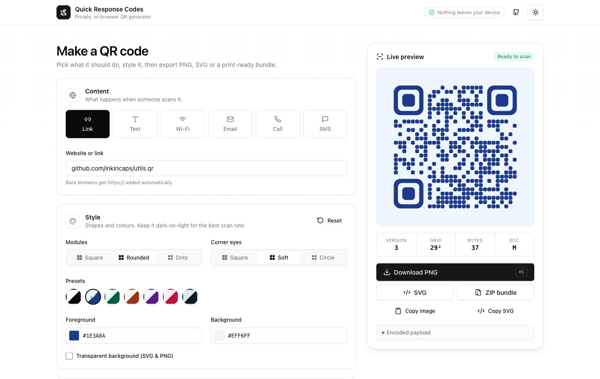
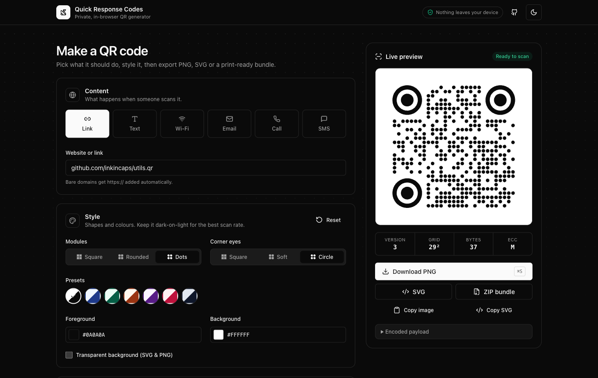

<div align="center">

# Quick Response Codes · `utils.qr`

**A fast, private QR code generator that runs entirely in your browser.**

Style it, drop in a logo, export PNG / SVG / EPS. No server, no tracking, no sign-up.



</div>

---

## Contents

- [Why this exists](#why-this-exists)
- [Features](#features)
- [Quick start](#quick-start)
- [Using the app](#using-the-app)
- [Content types and payload formats](#content-types-and-payload-formats)
- [Error correction, explained](#error-correction-explained)
- [Export formats](#export-formats)
- [How it works](#how-it-works)
- [Project structure](#project-structure)
- [Tech stack](#tech-stack)
- [Scripts](#scripts)
- [Deploying](#deploying)
- [Browser support](#browser-support)
- [Troubleshooting](#troubleshooting)
- [Contributing](#contributing)
- [License](#license)

---

## Why this exists

Most online QR generators upload your data to a server, add tracking redirects, watermark the output, or lock vector formats behind a paywall. This tool does none of that:

- **Private by design.** Your text, Wi-Fi passwords and logos never leave the tab. Everything is computed in JavaScript on your device.
- **Static codes only.** The QR code contains exactly what you typed. There is no short-link redirect that can expire or be monetised later.
- **Print-ready.** You get a lossless SVG, a high-resolution PNG (up to 4096 px) and a monochrome EPS for print shops.

## Features

| Area | What you get |
| --- | --- |
| **Content types** | Link, plain text, Wi-Fi network, email, phone call, SMS. Each has its own form and builds the correct payload. |
| **Styling** | Square, rounded or dot modules · square, soft or circular corner "eyes" · 7 colour presets · custom foreground / background · transparent background |
| **Logo** | Drag-and-drop or click to upload. Modules under the logo are **cleared** (not just covered), and the logo sits on a padded plate. Adjustable size from 12% to 30%. |
| **Error correction** | L / M / Q / H with plain-English guidance. Adding a logo raises the level to **H** automatically. |
| **Live feedback** | Instant preview, plus QR version, grid size, payload bytes and ECC level. Warnings for low contrast, inverted colours, a small quiet zone, or a logo with low error correction. |
| **Export** | PNG (512 / 1K / 2K / 4K), SVG, a ZIP bundle (SVG + PNG + EPS + a README with the settings), copy PNG to clipboard, copy SVG markup |
| **UX** | Light / dark / system theme · ⌘S / Ctrl+S to download PNG · fully keyboard-operable · responsive layout where the preview sits under the input on mobile · respects `prefers-reduced-motion` |

<details>
<summary><strong>Dark theme screenshot</strong></summary>



</details>

## Quick start

**Requirements:** Node.js 18+ and npm (pnpm and yarn work too).

```bash
git clone https://github.com/inkincaps/utils.qr.git
cd utils.qr
npm install
npm run dev
```

Open the URL Vite prints (usually <http://localhost:5173>).

To build a production bundle:

```bash
npm run build     # type-checks, then outputs static files to dist/
npm run preview   # serves dist/ locally to check the build
```

## Using the app

1. **Choose a content type**: Link, Text, Wi-Fi, Email, Call or SMS.
2. **Fill in the form.** The preview updates as you type.
3. **Style it** (optional): choose module and eye shapes, then a preset or your own colours.
4. **Add a logo** (optional): drop an image on the Logo card. Square images with some padding look best.
5. **Tune advanced settings** (optional): error correction level, quiet zone and PNG export size.
6. **Export**: *Download PNG* (or ⌘S / Ctrl+S), *SVG*, *ZIP bundle*, or copy to the clipboard.

> **Tip:** Always test-scan the final code with a couple of different phones before printing, especially if you changed colours, used dots, or added a logo.

## Content types and payload formats

Each form produces a standard string that iOS and Android camera apps recognise:

| Type | Payload | Notes |
| --- | --- | --- |
| Link | `https://example.com` | Bare domains (`example.com`) get `https://` added. Any URI scheme you type yourself (`ftp:`, `myapp:` …) is kept as-is. |
| Text | `any UTF-8 text` | Emoji and non-Latin scripts are supported (byte mode, UTF-8). |
| Wi-Fi | `WIFI:T:WPA;S:<ssid>;P:<password>;H:true;;` | `\ ; , : "` in the SSID or password are backslash-escaped as the format requires. `T` is `WPA`, `WEP` or `nopass`. `H:true` marks a hidden network. |
| Email | `mailto:to@example.com?subject=…&body=…` | Spaces are encoded as `%20` (not `+`) so mail clients display them correctly. |
| Call | `tel:+919876543210` | Formatting characters are removed; a leading `+` is kept. |
| SMS | `SMSTO:+15550100:message` | Widely supported format that pre-fills the message. |

You can always see the exact string under **Encoded payload** below the preview.

## Error correction, explained

QR codes use Reed–Solomon error correction, which lets a scanner recover data even when part of the code is damaged or hidden. Higher levels are more robust but need more modules, so the code gets denser.

| Level | Recovers up to | Use it for |
| --- | --- | --- |
| **L** | ~7% | Screens and clean digital use, where you want the smallest code |
| **M** | ~15% | General print (default) |
| **Q** | ~25% | Labels, packaging, textured surfaces |
| **H** | ~30% | Codes with a logo, outdoor signage, anything that may get scuffed |

A centred logo destroys the modules behind it, so the app switches to **H** when you add one, and warns you if you switch back to L or M.

## Export formats

| Format | Best for | Details |
| --- | --- | --- |
| **SVG** | Web, design tools (Figma, Illustrator), large-format print | Vector graphic: infinitely scalable and tiny. Includes your colours, shapes and logo (embedded as a data URI). |
| **PNG** | Docs, slides, social media, messaging | Rasterised from the SVG at 512, 1024, 2048 or 4096 px square. Supports a transparent background. |
| **EPS** | Print shops and older DTP workflows | **Monochrome (black on white), without the logo or custom shapes.** Generated by `qr-image` from the same payload and error correction level. |
| **ZIP** | Handing off to someone else | SVG + PNG + EPS + `README.txt` recording the payload, error correction level, QR version and PNG size. |

File names come from the payload, e.g. `inkincaps.com` → `qr-inkincaps-com.png`.

## How it works

```
 form fields ──► buildPayload() ──► qr-image.matrix() ──► renderSVG() ──► 
   (payload.ts)                       (encode + mask)        (qr.ts)              live preview
                                                                │
                                         ┌──────────────────────┼────────────────────────┐
                                         ▼                      ▼                        ▼
                                    SVG download        svgToPng(): canvas        qr-image EPS
                                                         → PNG / clipboard        (print bundle)
```

1. **Payload.** `src/lib/payload.ts` turns the active form into the right string (see the table above).
2. **Encoding.** [`qr-image`](https://github.com/alexeyten/qr-image) picks the smallest QR version that fits, chooses the best mask, and returns a boolean module matrix.
3. **Rendering.** `src/lib/qr.ts` draws its own SVG from that matrix:
   - Ordinary modules are joined into a single `<path>` (squares, rounded squares or circles), so even version-40 codes stay light.
   - The three 7×7 finder patterns are skipped in the main pass and redrawn as styled "eyes" with `fill-rule="evenodd"`.
   - With a logo, every module inside the logo box (plus a 1-module border) is left out, and a rounded plate in the background colour is drawn under the image.
4. **Preview.** The SVG is shown through an `` data URI rather than injected HTML. The browser renders SVG images in a sandbox (no scripts, no DOM access), so user content in the SVG can't execute.
5. **Rasterising.** For PNG and clipboard, the SVG is drawn onto a `<canvas>` at the chosen size and encoded with `canvas.toBlob()`.

### Why not `qrcode-svg`?

Earlier versions used `qrcode-svg` for rendering. Its version picker under-counts the header bits, so inputs near a capacity limit throw `code length overflow` (for example, a 58-character URL at level H). `qr-image` sizes these correctly and was already used for EPS, so every format now comes from a single encoder.

## Project structure

```
utils.qr/
├── index.html                    # HTML shell, meta tags
├── public/origami.png            # favicon
├── docs/                         # README screenshots
├── src/
│   ├── main.tsx                  # React root + ThemeProvider
│   ├── App.tsx                   # the whole UI: editor, preview, export actions
│   ├── index.css                 # Tailwind layers, theme tokens, grid/checker/range styles
│   ├── components/
│   │   ├── controls.tsx          # Section, Segmented, Slider, ColorField, Field
│   │   └── ui/                   # shadcn/ui primitives (button, input, tooltip, dropdown…)
│   └── lib/
│       ├── payload.ts            # content type → payload string builders
│       ├── qr.ts                 # matrix, SVG renderer, PNG/EPS export, colour contrast
│       ├── buffer-polyfill.ts    # Buffer global that qr-image needs in the browser
│       └── utils.ts              # cn() class merger
├── vite.config.ts                # @ alias, Buffer/process browser shims
└── tailwind.config.js
```

## Tech stack

- **React 18** + **TypeScript**, built with **Vite 6** (SWC)
- **Tailwind CSS 3** + **shadcn/ui** (Radix primitives) + **lucide-react** icons
- **next-themes** for light / dark / system theme
- **qr-image** for QR encoding and EPS output
- **JSZip** for the export bundle
- **buffer** / **process** polyfills, so the Node-oriented `qr-image` runs in the browser

## Scripts

| Command | What it does |
| --- | --- |
| `npm run dev` | Start the Vite dev server with HMR |
| `npm run build` | Type-check (`tsc -b`) and build to `dist/` |
| `npm run preview` | Serve the production build locally |
| `npm run lint` | Run ESLint |

## Deploying

The build is a fully static site with no environment variables or backend, so any static host works:

- **Vercel / Netlify / Cloudflare Pages:** build command `npm run build`, output directory `dist`.
- **GitHub Pages:** build, then publish `dist/`. If it's served from a sub-path (e.g. `/utils.qr/`), set `base: "/utils.qr/"` in `vite.config.ts`.
- **Any web server / S3 bucket:** upload the contents of `dist/`.

## Browser support

Works in all current versions of Chrome, Edge, Firefox and Safari.

- **Copy image** uses the async Clipboard API with `ClipboardItem`. It works in Chromium and Safari, and in Firefox 127+. If it isn't available, use *Download PNG*.
- ⌘S / Ctrl+S may be intercepted when the app runs inside an embedded webview. The button always works.

## Troubleshooting

**"That's more data than a QR code can hold…"**
A QR code holds at most 2,953 bytes at level L and about 1,273 at level H. Shorten the text, use a link instead of embedding content, or lower the error correction level.

**The code won't scan.**
Check the warnings under the preview. The usual causes are:
- Low contrast between foreground and background (aim for 4:1 or better).
- Light modules on a dark background. Some scanners can't read inverted codes.
- A quiet zone under 2 modules, especially when printed on a busy background.
- A large logo at low error correction. Use H and keep the logo at or under ~25%.

**The logo looks blurry in the PNG.**
Upload a bigger source image (≥ 512 px) or an SVG, and export at 2K or 4K.

**The EPS has no colours or logo.**
That's intentional. The EPS is a plain monochrome master for print. Use the SVG for a styled vector.

## Contributing

Issues and pull requests are welcome.

1. Fork and create a branch: `git checkout -b feat/my-change`
2. `npm install && npm run dev`
3. Make your change. Keep `npm run build` and `npm run lint` passing.
4. Test-scan generated codes with a real phone if you touch `lib/qr.ts` or `lib/payload.ts`.
5. Open a PR describing the change, with a screenshot for UI changes.

Ideas on the roadmap: vCard / calendar event / geo payloads, gradient fills, batch generation from CSV, and a PWA mode for offline use.

## License

MIT, as declared in `package.json`. © Inkincaps.
